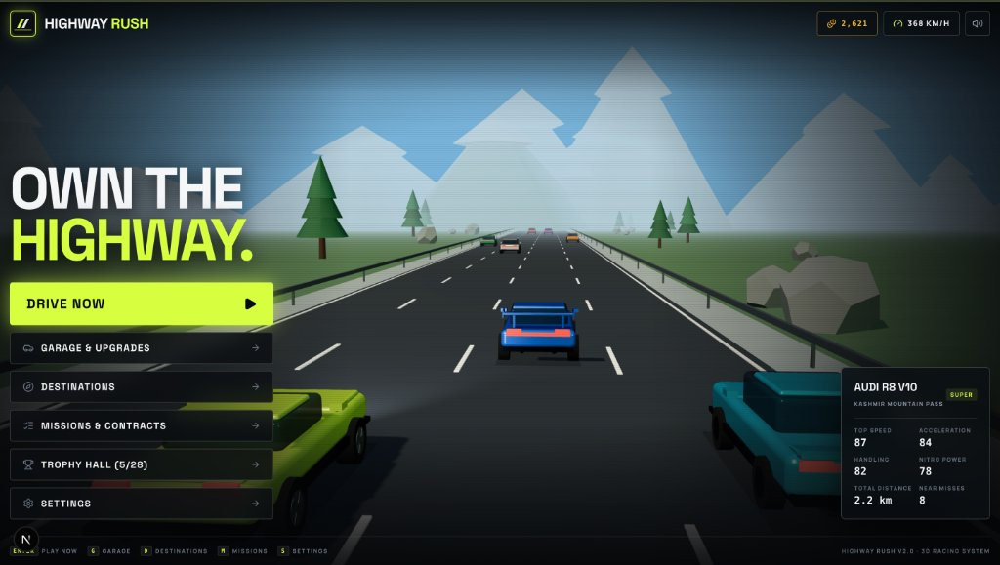
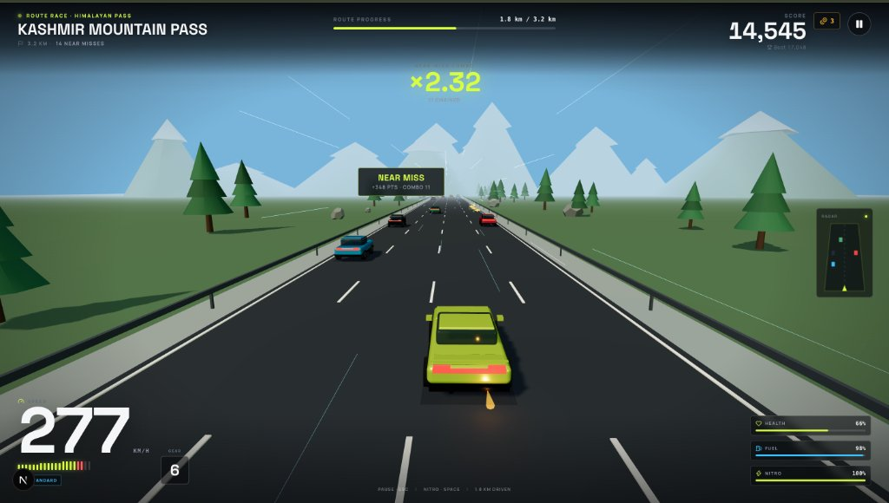
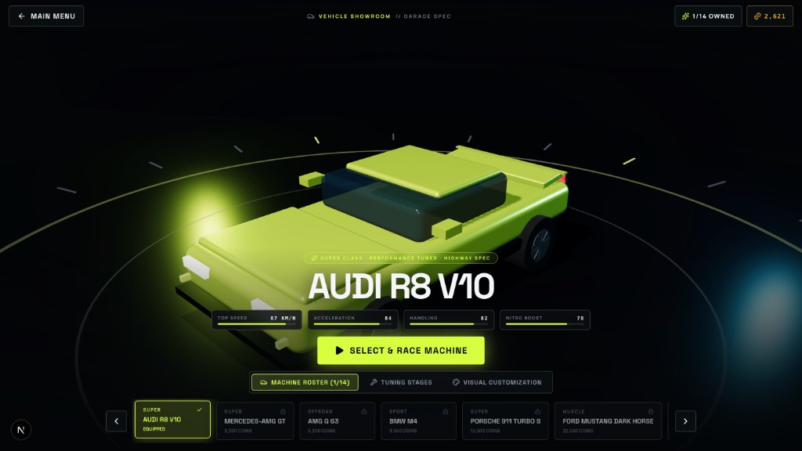
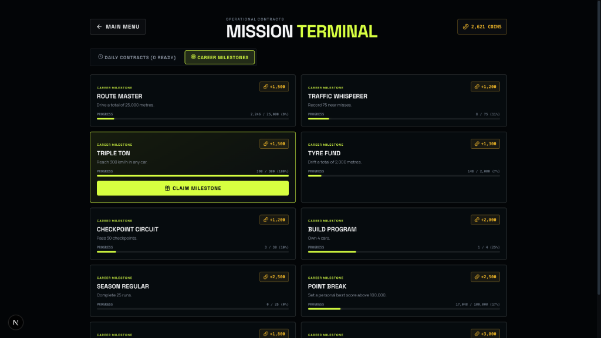

# Highway Rush — Own the Highway

<p align="center">
  
</p>

A premium, mobile-first 3D arcade racer built with **Next.js App Router**, **TypeScript**, **React 19**, **Three.js**, **styled-components**, **Zustand** and **Motion**. Thread traffic across eight distinct destinations, chain high-speed near misses, fire dynamic nitro with exhaust flames, build and tune a fourteen-car garage, and complete operational missions. Everything runs directly in the browser with zero buffering at a rock-solid 60 FPS — no backend, database, account system, or API keys required.

**Built by Umar Nazir.**

---

## Visual Experience & Game Gallery

| **Home & Highway Flow** | **Real-Time 3D Gameplay** |
|:---:|:---:|
|  |  |
| *Live highway preview, moving AI traffic, instant-launch HUD* | *270+ km/h cruising, near-miss combos, radar minimap, nitro fire* |
| **3D Vehicle Showroom & Tuning** | **Mission Terminal & Contracts** |
|  |  |
| *360° interactive turntable, stage upgrades & custom visual tuning* | *Daily contracts, career milestones & claimable coin bounties* |

---

## Highlights

- **Real 3D racing** — procedural highways, traffic, scenery, lighting and vehicles rendered with Three.js.
- **Eight destinations** — Kashmir Mountain Pass, Alpine Highway, Dubai Night Drive, Desert Expressway, Coastal Highway, Snow Valley, Forest Route and Tokyo Neon Streets. Each has its own palette, weather, surface, visibility, hazards, traffic mix and procedural soundtrack.
- **Fourteen-car garage** — coupe, supercar, saloon, SUV, muscle and electric silhouettes inspired by modern performance machines. Rotate every car in a live 3D studio, then fit paint, rims, wheels, spoilers, decals, underglow and performance upgrades.
- **Multiple steering methods** — Auto, gyroscope tilt, touch buttons, touch drag, keyboard and gamepad, all persisted locally. Tilt steering includes permission gating, calibration, dead zone, sensitivity, smoothing, maximum angle and a reverse direction option.
- **Progression** — cars, routes, four upgrade trees, 32 trophies, daily and long-term missions, lifetime statistics and a local leaderboard.
- **Procedural audio** — engine profiles tied to RPM, throttle, speed and gear, plus tyre slip, nitro, impacts, near misses, ambience, music and interface cues synthesized with the Web Audio API.
- **Responsive by design** — full-screen racing, translucent HUD, safe-area support, swipeable car and route carousels, a fixed mobile bottom navigation bar, and spacious desktop layouts.
- **Accessible feedback** — keyboard and gamepad support, visible focus states, reduced-motion support, adjustable UI scale, graphics presets and performance mode.

## Requirements

- Node.js **20.9+**
- npm 10+
- A modern browser with **WebGL 2** and **Web Audio**
- A secure context (**HTTPS or localhost**) for motion sensors on iOS and modern browsers

## Getting Started

```bash
npm install
npm run dev
```

Open [http://localhost:3000](http://localhost:3000).

### Production

```bash
npm run build
npm run start
```

### Quality checks

```bash
npm run typecheck   # TypeScript, no emit
npm run lint        # ESLint flat config
npm run build       # Production build and type check
```

## Routes

| Route | Purpose |
| --- | --- |
| `/` | Main menu, active car, featured destination and progress snapshot |
| `/play` | Race setup: destination, car, difficulty, race or endless mode |
| `/garage` | 3D viewer, purchases, visual customization and performance upgrades |
| `/destinations` | Route carousel, unlock requirements, surface briefings and records |
| `/missions` | Daily and long-term objectives |
| `/trophies` | Trophy cabinet with progress and rewards |
| `/statistics` | Lifetime driving statistics and recent runs |
| `/settings` | Graphics, audio, steering, gameplay, accessibility and save data |
| `/how-to-play` | Controls, scoring, race rules and systems |
| `/leaderboard` | Local run leaderboard |
| `/credits` | Credits, asset notes and project details |

The fixed mobile navigation links to **Home**, **Garage**, **Drive**, **Rewards** and **Settings**; Rewards points to missions. Active route state is shown with both colour and `aria-current`.

## Controls

### Keyboard

Default bindings, all remappable in **Settings → Controls**:

| Action | Default |
| --- | --- |
| Steer left | `←` |
| Steer right | `→` |
| Accelerate | `↑` |
| Brake | `↓` |
| Nitro | `Space` |
| Pause | `Escape` |

### Touch

Choose a method in **Settings → Controls**:

- **Auto** — uses tilt on supported sensor devices, with automatic button fallback if motion access is denied, unavailable or unsupported. Desktop and non-sensor devices use the standard controls.
- **Tilt** — steer by rotating the device. The first reading is captured as neutral. Tap **Re-centre** in the HUD during a race to set a new neutral angle.
- **Touch buttons** — hold the left/right steering pad; use the brake and nitro buttons.
- **Touch drag** — drag horizontally anywhere in the steering layer to steer; release to roll back to centre.
- **Keyboard** — useful on tablets with a keyboard attached.
- **Gamepad** — left stick steers, triggers accelerate/brake, shoulder or face buttons fire nitro, and Start pauses.

Tilt tuning lives in **Settings → Controls**: dead zone, sensitivity, smoothing, maximum angle, reverse direction and a live sensor readout. Motion permission is requested only from a user gesture such as **Start race** or **Test sensor** — never on page load. If the sensor is unavailable, unsupported or denied, the game explains why and falls back to touch buttons rather than leaving the player without steering.

### Audio

Browsers require a user gesture before audio can start. Pressing **Start race** or interacting with the menu unlocks the audio context. Engine, tyre, ambience, music, interface and gameplay buses have separate volume controls.

## Scoring

- Distance: **2 points per metre**, plus a speed component
- Near miss: **150 × combo multiplier**
- Coin: **35 × multiplier** and **+1 coin**
- Checkpoint (every 700 m): **600 + 150 × checkpoint index**
- Finish bonus: **5000**
- Drift: **4 points per metre**

Runs end on finish, critical damage, empty fuel or quitting. Rewards are paid once per run, and trophy progress updates both live and at the results screen.

## Garage and Upgrades

The garage stores an independent build for every car:

- paint, rim colour, wheel style, spoiler, decal and underglow
- four performance trees — engine, tyres, brakes and nitro
- three stages per tree, purchased with coins
- effective stats feed directly into the Three.js race model
- **Select this car** and **Race it** preserve the active car across reloads

Upgrades are additive and optional in the persisted schema, so saves created before the upgrade system remain valid. The save key remains `highway-rush-save-v2`.

## Persistence

All progress is stored locally under the `highway-rush-save-v2` key using Zustand's `persist` middleware. This includes settings, coins, owned cars, customizations and upgrades, route unlocks, trophies, missions, statistics and recent run history.

- No account or server is involved.
- Clearing site data resets progress.
- The leaderboard is explicitly local-only and does not represent global rankings.
- Saves are per browser and per origin, so `localhost` and a deployed domain do not share progress.

## Assets and Licensing

### Vehicles and destinations

Every vehicle and environment is **original procedural Three.js geometry** created for this project. The roster is styled after real-world performance cars for recognisability, and route names reference real-world driving archetypes, but the game is **not affiliated with, sponsored by or endorsed by any vehicle manufacturer**. Manufacturer and model names remain trademarks of their respective owners.

No licensed OEM model, manufacturer CAD data, photogrammetry scan or real-location capture is bundled. The `CarAsset` metadata in `lib/data/cars.ts` records this honestly:

```ts
asset: {
  kind: 'procedural',
  licence: 'Original procedural asset',
  credit: 'Highway Rush',
  note: '...',
}
```

The optional `kind: 'glb'` and `assetUrl` fields are the integration point for a future, verifiably licensed GLB/GLTF vehicle. No external model is claimed or silently substituted today.

### Audio

All sound is synthesized at runtime by `lib/audio/AudioManager.ts` using the Web Audio API. No commercial sample packs, streamed tracks or ripped game audio are bundled. This keeps the project dependency-free and honestly attributable. The procedural soundtrack can be replaced with licensed music and samples later without changing game logic.

### Fonts and libraries

- Inter, Manrope and Space Grotesk are bundled locally through `@fontsource-variable` (SIL Open Font License).
- Next.js, React, Three.js, styled-components, Zustand, Motion and Lucide are used under their respective open-source licences.

## Architecture

```text
app/                     Next.js App Router pages, layout, global styles
components/
  game/                  RaceStage, HUD, touch controls, tilt feedback, preview canvas
  layout/                NavBar, MobileBottomNav, Footer, PageShell
  motion/                Route and reveal transition primitives
  providers/             Theme, MotionConfig, store hydration, global audio
  ui/                    Buttons, panels, modals, toasts, feedback, controls
lib/
  audio/                 Procedural Web Audio manager
  data/                  Cars, upgrades, destinations, missions, trophies
  game/                  Three.js engine, environment, car model, input, tilt, preview
  hooks/                 Menu audio lifecycle
  store/                 Zustand game and UI stores
  ui/                    Theme, formatting utilities, styled-components types
public/                  App icon
```

### Rendering and performance

- A single WebGL renderer and race loop are owned by `RaceStage` and disposed on unmount.
- Graphics settings apply live where possible; antialiasing changes require a renderer rebuild.
- Performance mode, render scale, shadow quality and effects levels reduce GPU cost on lower-end devices.
- Input listeners, sensor listeners, audio timers and animation frames are cleaned up to avoid duplicate loops.
- The race renderer is paused when the tab is hidden.

## Accessibility

- Reduced motion is respected through `MotionConfig reducedMotion="user"`, plus a global `prefers-reduced-motion` CSS fallback.
- UI scale is adjustable.
- All primary controls have visible focus states and keyboard equivalents.
- The mobile navigation exposes `aria-current`; dialogs are labelled and portalled; live HUD updates use restrained announcements.
- Tilt is optional. Every sensor path has a button, drag, keyboard or gamepad fallback.

## Deployment

### Vercel

1. Push the repository to GitHub, GitLab or Bitbucket.
2. Import the project in Vercel.
3. Keep the detected framework preset **Next.js**.
4. Build command: `npm run build`; install command: `npm install`.
5. No environment variables are required.

Redeploy after changing assets or environment configuration. Motion sensors require **HTTPS** in production; Vercel provides this automatically.

### Other Node hosts

```bash
npm ci
npm run build
npm run start
```

Any Node-compatible host works. Serve over HTTPS so sensor permission and modern browser APIs remain available. The game is fully client-side apart from Next.js page rendering.

## Browser Notes

- Audio starts only after a user gesture, by browser policy.
- WebGL is required; unsupported devices see a graceful error state.
- iOS requires an explicit motion-permission prompt triggered by a user gesture.
- Touch controls are optimised for landscape play, but portrait is fully supported.
- Progress is per-browser and per-origin.
- Headless or GPU-blocked browsers may run the race slowly; the game waits for its own countdown rather than assuming wall-clock timing.

## Credits

Design, development and direction: **Umar Nazir**.

Built with Next.js, React, TypeScript, Three.js, styled-components, Zustand, Motion and Lucide.

**Built by Umar Nazir.**
